# ⛽ Global Fuel Prices & Taxation Trends

### A multi-fuel analytics suite and fiscal evaluation built in Tableau

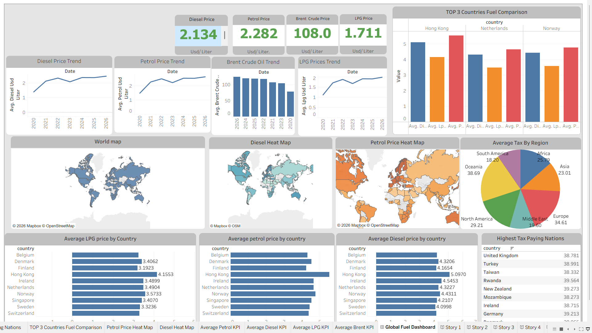

**An interactive BI project exploring retail fuel prices (Petrol, Diesel, LPG), Brent crude oil, and fuel taxation across 84 countries and 7 regions.**

[📊 Run the Project](#-how-to-view--run-the-project) • [📑 Technical Report (DOCX)](documentation/Global_Fuel_Prices_Project_Documentation.docx) • [📄 Story Deck (PDF)](documentation/Global_Fuel_Prices_Tableau_Story.pdf)

---

## 📑 Table of Contents

- [Executive Summary](#-executive-summary)
- [Key Metrics](#-key-metrics)
- [Objectives](#-objectives)
- [Repository Structure](#-repository-structure)
- [Dataset & Schema](#-dataset--schema)
- [Dashboard & Visual Analysis](#-dashboard--visual-analysis)
- [Tableau Story](#-tableau-story)
- [Key Findings](#-key-findings)
- [Limitations & Future Work](#-limitations--future-work)
- [How to View & Run](#-how-to-view--run-the-project)
- [Author](#-author)

---

## 📌 Executive Summary

Crude oil trades on a shared global benchmark, yet pump prices for **Petrol**, **Diesel** and **LPG** differ sharply from country to country. This project asks *why*, and how much of the gap is explained by taxation.

Using **27,468 observations** across **84 countries** (January 2020 – April 2026), the Tableau workbook (`global_fuel_project_and_taxation_final.twbx`) brings together:

- country-level price benchmarking for all three fuels,
- global price trends over time,
- the Brent crude benchmark,
- regional tax averages and the highest-taxing countries,

all presented through an interactive dashboard and an 8-slide guided Tableau Story.

---

## ⚡ Key Metrics

| Metric | Value |
| :-- | :-- |
| Data records | 27,468 |
| Countries | 84 |
| Regions | 7 |
| Time window | 2020 – 2026 |
| Fuel types | 3 (Petrol, Diesel, LPG) |
| Views & dashboards | 14 |

---

## 🎯 Objectives

| ID | Focus | Deliverable in Tableau |
| :-- | :-- | :-- |
| **OBJ-01** | Geospatial view | World map of fuel prices and tax rates |
| **OBJ-02** | Country benchmarking | Ranked average Petrol, Diesel and LPG prices |
| **OBJ-03** | Price trends | Time-series lines for each fuel, 2020–2026 |
| **OBJ-04** | Crude oil benchmark | Brent crude trend viewed alongside retail prices |
| **OBJ-05** | Fiscal policy | Average tax by region and top tax-paying countries |
| **OBJ-06** | Top-3 comparison | Side-by-side fuel prices for the three selected countries |
| **OBJ-07** | Executive synthesis | One dashboard plus an 8-slide Tableau Story |

---

## 📂 Repository Structure

```text
Global-Fuel-Prices-and-Taxation-Trends/
│
├── README.md
│
├── data/
│   └── global_fuel_prices_Dataset.csv                 # Cleaned master dataset (27,468 records)
│
├── tableau/
│   └── global_fuel_project_and_taxation_final.twbx    # Packaged workbook (data + sheets + story)
│
├── documentation/
│   ├── Global_Fuel_Prices_Project_Documentation.docx  # 16-section technical report
│   └── Global_Fuel_Prices_Tableau_Story.pdf           # Exported Tableau Story deck
│
└── images/                                            # Previews used in this README
    ├── 01-global-fuel-dashboard.png
    ├── 02-world-map.png
    ├── 03-average-petrol-by-country.png
    ├── 04-average-diesel-by-country.png
    ├── 05-average-lpg-by-country.png
    ├── 06-petrol-price-trend.png
    ├── 07-diesel-price-trend.png
    ├── 08-lpg-price-trend.png
    ├── 09-brent-crude-trend.png
    ├── 10-average-tax-by-region.png
    ├── 11-highest-tax-paying-nations.png
    ├── 12-top-three-country-comparison.png
    ├── 13-tableau-story.png
    └── 14-project-documentation.png
```

---

## 🗂️ Dataset & Schema

Source file: `data/global_fuel_prices_Dataset.csv`

| Field | Type | Role | Description |
| :-- | :-- | :-- | :-- |
| **Date** | Date | Dimension | Time sequence, Jan 2020 – Apr 2026 |
| **Country** | String | Dimension | Mapped using Tableau's Country/Region geographic role |
| **Region** | String | Dimension | 7 regions used for aggregation |
| **Income Level** | String | Dimension | World Bank class (High, Upper-Middle, Lower-Middle, Low) |
| **Subsidy Level** | String | Dimension | Indicator of national market regulation |
| **Petrol Price** | Number | Measure | Retail price per litre (USD) |
| **Diesel Price** | Number | Measure | Retail price per litre (USD) |
| **LPG Price** | Number | Measure | Retail price per litre (USD) |
| **Brent Crude Price** | Number | Measure | International benchmark, USD per barrel |
| **Tax Percentage** | Number | Measure | Combined fuel tax rate (excise, VAT, levies) |

> All comparisons use **averages** (`AVG()`), not sums, so countries or periods with more records are not over-weighted.

---

## 🖥️ Dashboard & Visual Analysis

### Executive Dashboard


*Figure 1. Global Fuel Prices and Taxation dashboard (Tableau)*

### 1. Geospatial Price & Tax Map

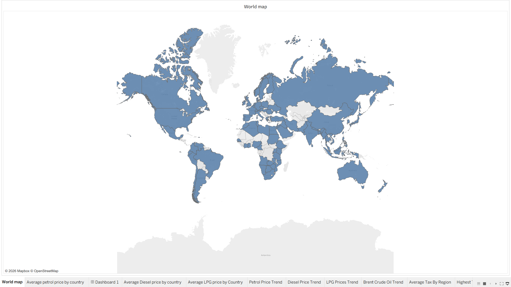

*Figure 2. World map with hover tooltips for country-level prices and tax*

### 2. Cross-Country Benchmarking

#### Average Petrol by Country

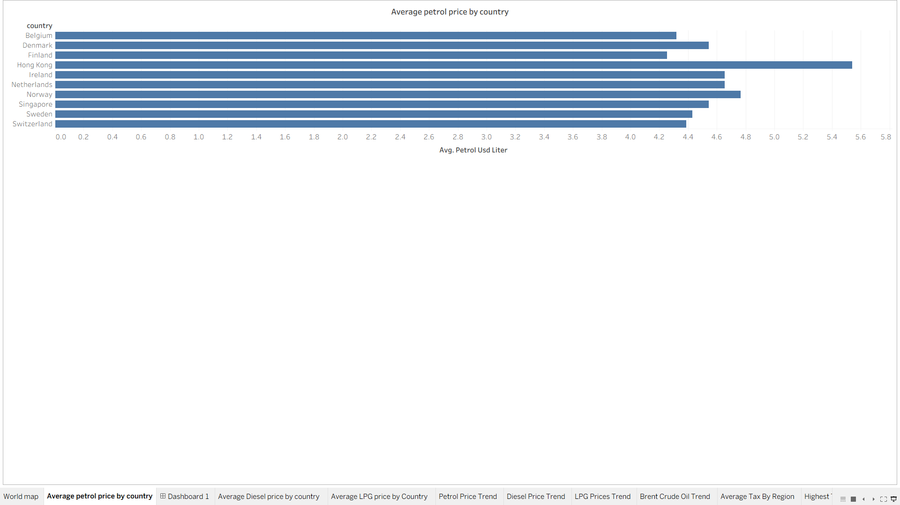

#### Average Diesel by Country

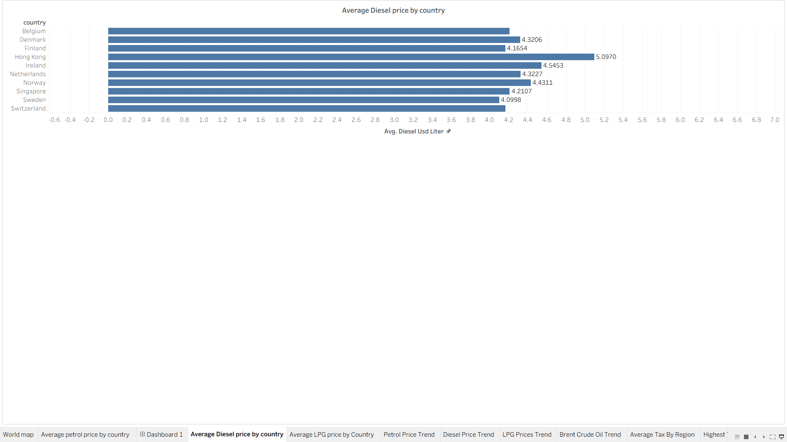

#### Average LPG by Country

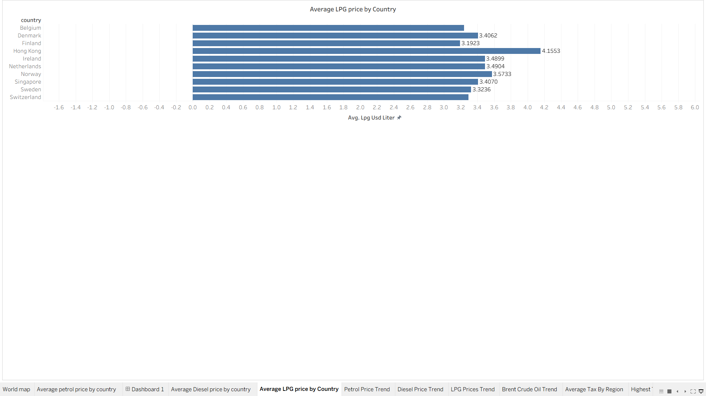

*Figures 3–5. Average retail price per litre (USD), top-ranked countries per fuel*

### 3. Price Trends & Brent Crude (2020 – 2026)

#### Petrol

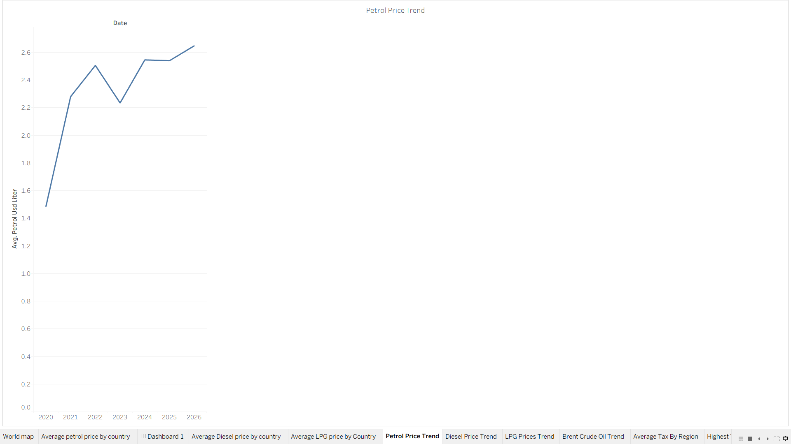

#### Diesel

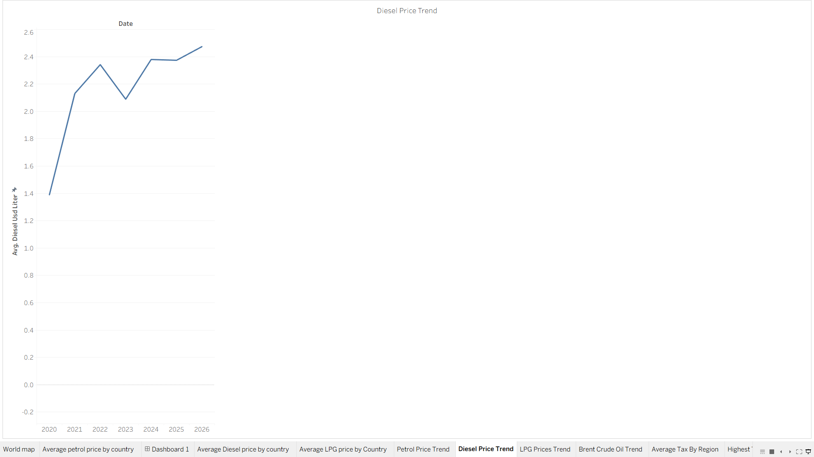

#### LPG

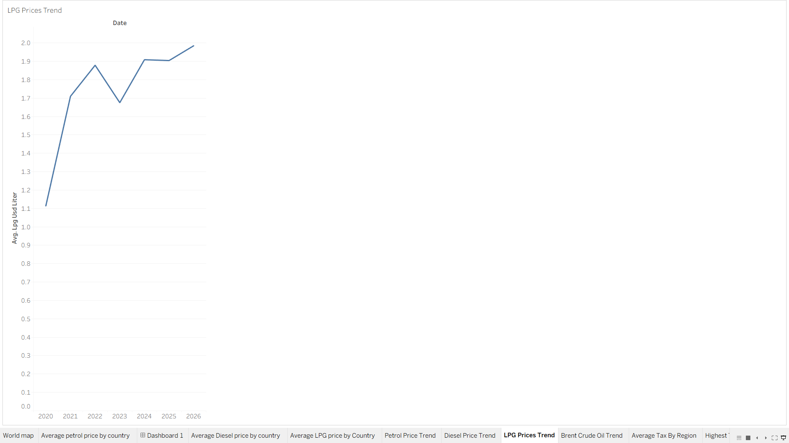

#### Brent Crude

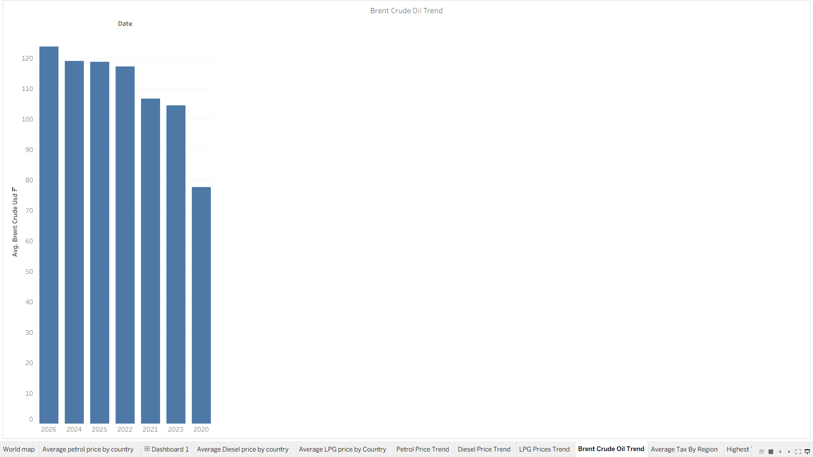

*Figures 6–9. Global average trends for each fuel and the Brent benchmark*

**What the trends show:** all three retail fuels follow the same pattern: a sharp rise from 2020 to 2022, a dip in 2023, then a steady recovery through 2026.

| Fuel | Approx. global average, 2020 | Approx. 2026 |
| :-- | :-: | :-: |
| Petrol | ~1.5 USD/L | ~2.65 USD/L |
| Diesel | ~1.4 USD/L | ~2.5 USD/L |
| LPG | ~1.1 USD/L | ~2.0 USD/L |

*Values are read from the Tableau charts and are approximate.*

### 4. Regional Taxation

#### Average Fuel Tax by Region

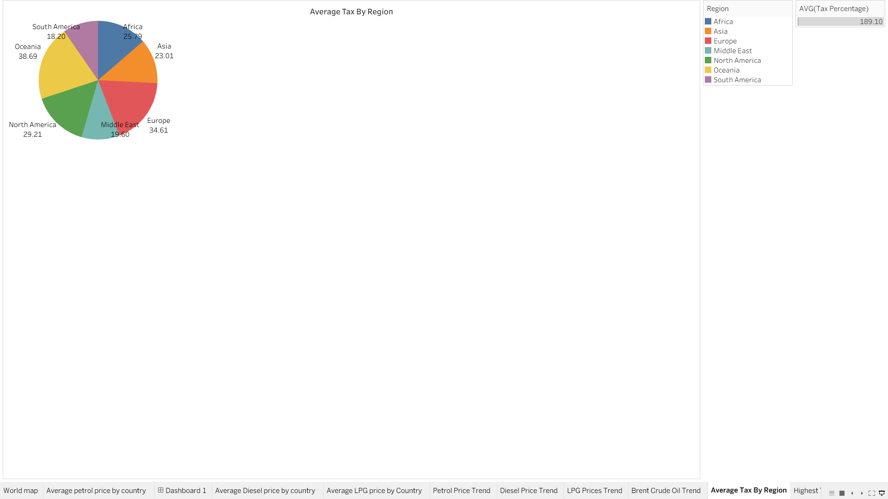

#### Highest Tax-Paying Countries

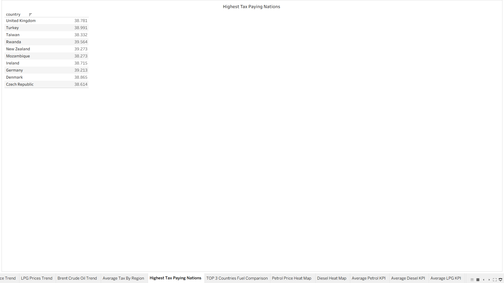

*Figures 10–11. Regional tax averages and the countries with the highest fuel tax*

| Region | Avg. tax (%) |
| :-- | :-: |
| Oceania | 38.69 |
| Europe | 34.61 |
| North America | 29.21 |
| Africa | 25.79 |
| Asia | 23.01 |
| Middle East | 19.60 |
| South America | 18.20 |

Countries at the top of the tax ranking sit at roughly **38–39.6%**, led by Rwanda (39.56), New Zealand (39.27) and Germany (39.21).

### 5. Top-3 Country Comparison

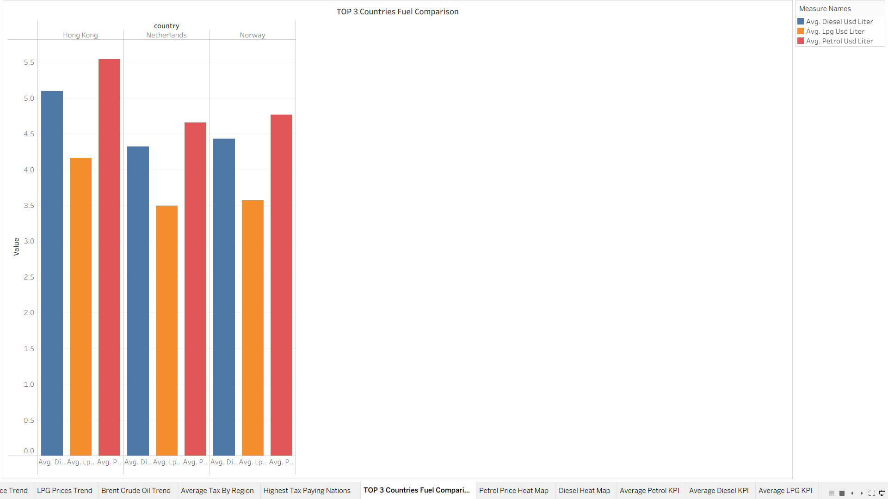

*Figure 12. Petrol, Diesel and LPG averages for Hong Kong, the Netherlands and Norway*

In all three countries Petrol is the most expensive fuel, followed by Diesel, then LPG. Hong Kong is the highest of the three on every fuel.

---

## 📖 Tableau Story

The workbook includes an **8-slide Tableau Story** that walks from country price rankings to trends, the crude benchmark and finally tax policy.

| Slide | Topic |
| :-: | :-- |
| 1 | Overview: average Petrol and LPG price by country |
| 2 | Fuel price comparison across the top 3 countries |
| 3 | Global diesel price trend |
| 4 | Global petrol price trend |
| 5 | Global LPG price trend |
| 6 | Brent crude oil trend |
| 7 | Regional fuel taxation |
| 8 | Top tax-paying countries |


[](documentation/Global_Fuel_Prices_Tableau_Story.pdf)

---

## 📑 Technical Documentation

A 16-section report covers data preparation, methodology, calculated metrics, insights and limitations.

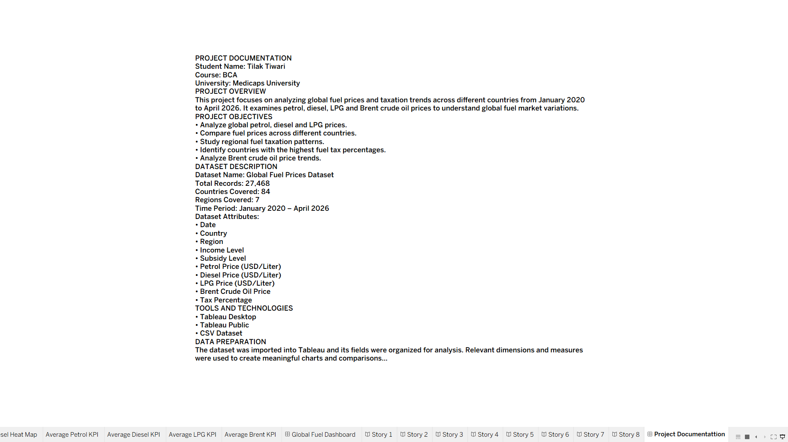

[](documentation/Global_Fuel_Prices_Project_Documentation.docx)

---

## 💡 Key Findings

1. **Prices move together over time.** Petrol, Diesel and LPG share the same rise–dip–recovery shape between 2020 and 2026, in line with the upward movement of Brent crude over the same window.
2. **Clear fuel tiering.** In the countries shown, LPG is consistently cheaper than Diesel, which is cheaper than Petrol.
3. **Tax varies widely by region.** Average fuel tax ranges from about 18% in South America to nearly 39% in Oceania, with Europe the second highest.
4. **High-price countries cluster at the top of the rankings.** The same small set of countries (for example Hong Kong, Norway and the Netherlands) appears at the top of the price charts.

> **Context from energy economics** (not directly tested in this dataset): countries with large fixed per-litre taxes tend to see smaller percentage swings at the pump when crude moves, and retail prices usually rise faster than they fall ("rockets and feathers"). Testing these would be a natural next step; see below.

---

## 🔭 Limitations & Future Work

**Limitations**

- Prices are in USD, so exchange-rate moves can affect comparisons.
- Nominal prices ignore purchasing power: a low price in a lower-income country can still be a heavier burden for households.
- Averages hide within-country variation and differences in the number of observations.

**Possible next steps**

- Add a **Fuel Affordability Index** (share of daily income needed to buy one litre).
- Show Brent crude as a **line chart over time** (currently a bar chart sorted by value) and add a retail-vs-Brent correlation view.
- Test the pass-through ideas above using tax-share data.
- Connect live price and FX feeds for automatic refresh.
- Add EV adoption and carbon-pricing data to study the transition effect.

---

## 🚀 How to View & Run the Project

1. **Clone the repository**

   ```bash
   git clone https://github.com/tilakkkk-09/Global-Fuel-Prices-and-Taxation-Trends.git
   cd Global-Fuel-Prices-and-Taxation-Trends
   ```

2. **Open the workbook**
   - Open `tableau/global_fuel_project_and_taxation_final.twbx` in **Tableau Desktop** or the free **Tableau Reader** (version 2020.2 or later).
   - All data is packaged inside the `.twbx`, so no extra setup is needed.

3. **Browse the supporting material**
   - [`Global_Fuel_Prices_Tableau_Story.pdf`](documentation/Global_Fuel_Prices_Tableau_Story.pdf) for the slide deck.
   - [`Global_Fuel_Prices_Project_Documentation.docx`](documentation/Global_Fuel_Prices_Project_Documentation.docx) for the full methodology.

---

## 👤 Author

**Tilak Tiwari**

- **Program:** Bachelor of Computer Applications (BCA)
- **Institution:** Medi-Caps University, Indore, India
- **GitHub:** [@tilakkkk-09](https://github.com/tilakkkk-09)

---
